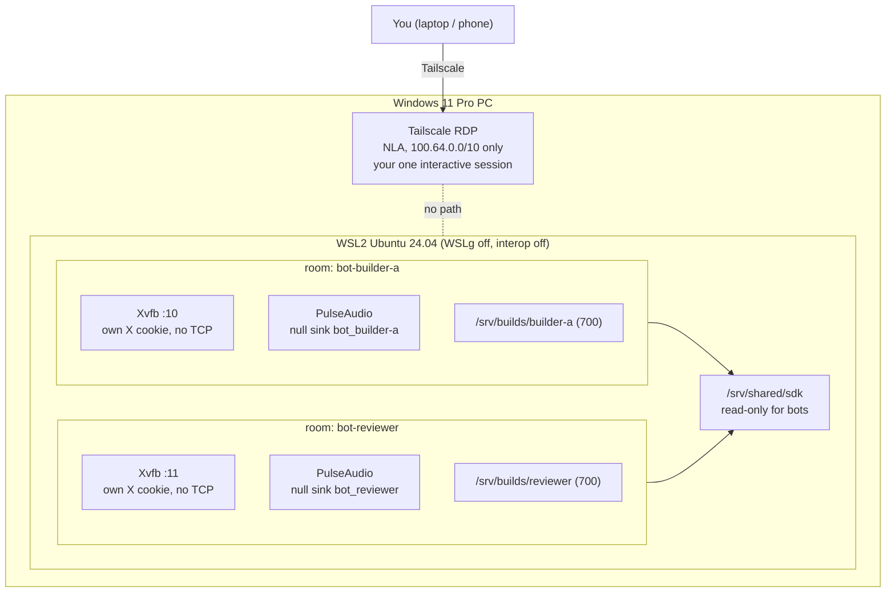

<p align="center"></p>

# Kiwi Tray

**TRAY = Tiny Rooms for Agents, Yours.**

Kiwi Tray turns one Windows 11 Pro PC into a shared build host for several coding agents ("bots").
Each bot gets its own room: a separate Linux user in WSL2 with its own home, work and cache directories,
X display and audio server. You keep the single interactive Remote Desktop session, reachable only over
Tailscale, and no bot can type into it, read its clipboard or play sound in it.

It was built to run iOS builds with [xtool](https://github.com/xtool-org/xtool) from Linux, but the
isolation layer works for any headless build or test agent.

## Why it is built this way
- **One RDP session is all Windows 11 Pro allows.** Multi-session patches (RDP Wrapper, termsrv edits) are
  unsupported and break the licence, so Kiwi Tray leaves that session to you and puts the bots elsewhere.
- **Bots are headless, so rooms live inside WSL2.** One Linux user per bot gives separate logins and
  config (`~/.config`, CLI auth), separate caches and file permissions, without the cost of a VM per bot.
- **Every input channel is private per room.** Each bot has its own Xvfb display guarded by its own X
  cookie, and its own PulseAudio server behind its own socket. WSLg and Windows interop are turned off, so
  nothing in WSL can reach your desktop, keyboard, clipboard or speakers.
- **Remote access stays on your tailnet.** RDP requires NLA and the firewall only accepts the Tailscale
  range.
- Heavier option, not included: one Hyper-V VM per bot.

## Architecture


## Input isolation
| channel | how it stays inside one room |
|---|---|
| display, keyboard, mouse | Xvfb `:N` per bot, `-nolisten tcp -nolisten local`, `-auth` with a per-bot cookie in a mode-700 dir |
| clipboard | X selections live in each bot's own X server; WSLg clipboard bridge off; interop off, so no `clip.exe`/`powershell.exe Get-Clipboard` |
| audio | PulseAudio per bot, socket under the bot's mode-700 `XDG_RUNTIME_DIR`, `auth-anonymous=0`; `PULSE_SERVER` points there, not at WSLg's shared `/mnt/wslg/PulseServer` |
| your desktop | `guiApplications=false` (no shared WSLg X `:0` or Wayland socket), `WAYLAND_DISPLAY` unset, Windows interop disabled |

## What each bot gets
| item | value (bot `NAME`, n-th in list) |
|---|---|
| Linux user | `bot-NAME` (no password; entry via `wsl -u`) |
| work dir | `/srv/builds/NAME/work` (mode 700) |
| cache | `/srv/builds/NAME/cache` |
| display | Xvfb `:(10+n)`, cookie at `/srv/builds/NAME/cache/Xauthority` |
| audio | PulseAudio null sink `bot_NAME` |

## Setup
1. **Windows** (elevated PowerShell): `windows\enable-rdp-tailscale.ps1` enables RDP with NLA and allows it
   only from `100.64.0.0/10`.
2. Copy `windows/wslconfig.example` to `%UserProfile%\.wslconfig` (it sets `guiApplications=false`), then
   `wsl --shutdown`.
3. **WSL2 Ubuntu 24.04**: copy `bots.example` to `bots.conf`, list your bot names, then
   `wsl/setup-build-host.sh`. Preview first with `DRY_RUN=1 wsl/setup-build-host.sh`. The script writes
   `/etc/wsl.conf` (systemd on, interop off); run `wsl --shutdown` once more if it says so.
4. **iOS SDK** (only for xtool): on a Mac, archive the needed parts of `/Applications/Xcode.app`, copy them
   to `/srv/shared/sdk`, then run once: `xtool sdk install /srv/shared/sdk/Xcode.app --slim`.
   For signing, use `xtool auth` with an App Store Connect API key. No Apple ID password is stored.

## Apple 개발자 팀 (2026-10-22~)
iOS·macOS 빌드 서명, TestFlight, App Store 출시는 모두 조직 **207 Studio (Team ID `H32W23F7UW`)**로 한다.
- Xcode/xcodebuild: `DEVELOPMENT_TEAM = H32W23F7UW`, `CODE_SIGN_STYLE = Automatic`.
- xtool: `xtool auth`에 쓰는 App Store Connect API 키는 207 Studio 팀에서 발급한 것만 쓴다. 키 파일·Issuer ID 값은 저장소에 넣지 않는다.
- TestFlight 업로드와 App Store 제출은 Mac에서 207 Studio 팀으로 한다. 예전 개인 팀으로 서명한 빌드는 올리지 않는다.
- App Store 판매자 이름은 App Store Connect > Business의 법인 정보(계약·세금·은행) 완료 뒤 207 Studio로 바뀐다(유일 님 몫). 상세: Kiwi `assets/account/apple-developer-207studio.md`.

## Usage
```
wsl -d Ubuntu-24.04 -u bot-NAME
cd "$WORK"
swb            # swift build with this bot's own cache and scratch path
```

## Limits
iOS Simulator, full xcodeproj builds, actool/xcstrings/Core ML compilation and App Store upload still need a
Mac. The per-bot displays are for Linux GUI and screenshot tools, not iOS simulators. Isolation is Linux
user separation inside one WSL2 VM, not a VM boundary: do not run mutually untrusted code side by side, and
remember that `/mnt/c` is still mounted.

## Security model
- RDP: NLA required, firewall allows only the Tailscale CGNAT range. Your tailnet ACLs are the outer boundary.
- Bots: no passwords, no sudo, homes and work dirs not readable by other bots.
- Secrets: the scripts create none and store none, apart from per-bot X cookies. Each bot logs in to its own
  tools under its own home.
- Bot names are validated (`^[a-z][a-z0-9-]{0,30}$`) before they reach `useradd` or systemd unit files.

## Migrating from Cubby
This project was called Cubby. Shell functions are now `tray_*`; the old `cubby_*` names still work as
wrappers. Users, paths and unit names did not change.

## Development
`tests/run.sh` runs the tests with plain bash (no installs). CI also runs ShellCheck.
See [AGENTS.md](AGENTS.md) if you are an agent working in this repo.

## License
MIT
